### **프로젝트 소개** 
TanTan은 지도를 중심으로 헬스장을 찾고, 비교하고, 문의까지 이어지게 만드는 웹앱입니다. 사용자는 네이버지도처럼 지도를 먼저 탐색하다가 핀을 클릭하면 왼쪽 슬라이드 패널로 해당 헬스장의 상세 정보가 자연스럽게 펼쳐지는 UI로, 원하는 헬스장을 빠르게 파악할 수 있습니다. 
헬스장 상세 페이지에서는 헬스장 이름/주소/사진/평균 별점/리뷰 목록을 확인할 수 있고, 마음에 들면 즐겨찾기로 저장하거나 **1:1 상담 채팅(비실시간, DB 기반)**으로 문의를 남길 수 있습니다. 채팅은 사용자와 헬스장 관리자가 여러 메시지를 주고받으며 기록이 남는 형태로, “문의 → 응답 → 기록 관리”가 간단하게 돌아가도록 구성합니다. 
TanTan은 사용자뿐 아니라 **헬스장 관리자(GYM_OWNER)**도 고려합니다. 헬스장 관리자는 본인 소속 헬스장만 등록/수정할 수 있고, 들어온 상담 채팅 목록을 확인해 응답할 수 있습니다. 또한 악성 리뷰 신고 등 운영에 필요한 최소 기능을 포함해, “헬스장 운영 관점”에서도 사용할 수 있게 설계했습니다. 
추가로 커뮤니티(게시글/댓글/대댓글)와 운동 기록(일일 기록, 월간 캘린더 표시) 기능을 통해, 단순한 지도 검색을 넘어 사용자 참여와 재방문을 만드는 서비스 구조를 갖추었습니다.
권한은 **일반 사용자(USER) / 헬스장 관리자(GYM_OWNER) / 관리자(ADMIN)**로 분리되고, 인증은 JWT Token 기반으로 구현하였습니다. 
## 🫂 팀원 소개
<table align="center">
  <tbody>
    <tr>
  <td align="center" width="150px">
    <a href="https://github.com/iamxoghks">
       
      <b> 김태환 </b>
    </a>
  </td>

  <td align="center" width="150px">
    <a href="https://github.com/2001056">
       
      <b> 이병찬 </b>
    </a>
  </td>

  <td align="center" width="150px">
    <a href="https://github.com/ybrocks">
       
      <b> 조강현 </b>
    </a>
  </td>

  <td align="center" width="150px">
    <a href="https://github.com/yune22">
       
      <b> 황정윤 </b>
    </a>
  </td>
</tr>
  </tbody>
</table>

## 🛠️ 기술스택
### 🧩 백엔드 기술

  
  
  
  
  
  

### 🎨 프론트엔드 기술

  
  
  
  
  
  
  
  
  
  

### 🗄️ 데이터 기술

  
  
  
  

### 🚀 인프라/배포

  
  
  
  
  
  

### 🧰 개발 도구

  
  
  
  
  
  

### 🤝 협업/기획 도구

  
  
  
  
  

### 🌐 외부 API 연동
| API | 사용 목적 | 적용 위치 |
| ---------- | ---------------------------------------------- | ---------------------------------------------- |
| **Naver Map API** | 주소를 좌표로 변환하는 **Geocoding API**와 차량 경로를 계산하는 **Driving Direction API**를 연동해 지도 탐색과 길찾기 경험을 제공합니다. | `MapController`, `GeocodingService`, `DrivingDirectionService`, `naver.map.*` 설정 |
| **사업자등록번호 조회 API** | 헬스장 관리자 권한 신청 시 사업자등록번호의 유효성과 정상 영업 여부를 검증해 허위 등록을 차단합니다. | `GymController`의 `/gym/apply`, `NtsBusinessApiClient`, `publicdata.nts.serviceKey` 설정 |

### 📦 사용 오픈소스
| 오픈소스 | 버전 | 사용 목적 | 라이선스 | 링크 |
| ---------- | ---------- | ---------- | ---------- | ---------- |
| Thumbnailator | 0.4.20 | 업로드 이미지의 비율을 유지한 썸네일 생성 및 원본/썸네일 분리 저장 | MIT | [coobird/thumbnailator](https://github.com/coobird/thumbnailator) |

### 🔍 사용한 핵심 기술
| 사용 기술 | 설명 |
| ---------- | ---------------------------------------------- |
| **Vue 3 Composition API** | 컴포넌트 로직을 기능별로 캡슐화하고 재사용성을 높이기 위해 Composition API와 자체 Composable(`useSession`, `useNotificationCenter` 등) 패턴을 적극 활용했습니다. |
| **Vite** | 기존 번들러 대비 압도적으로 빠른 HMR(Hot Module Replacement)과 빌드 속도를 제공하는 Vite를 도입하여 개발 생산성을 크게 향상시켰습니다. |
| **Axios Interceptor 기반 인증 제어** | Axios Interceptor를 통해 JWT Access Token을 전역적으로 관리하며, 만료 시 Refresh Token을 이용한 자동 갱신 및 동시 다발적인 요청을 처리하는 갱신 대기 큐(Wait Queue) 로직을 구현했습니다. |
| **Tailwind CSS & 커스텀 CSS** | 유틸리티 퍼스트 프레임워크인 Tailwind CSS를 사용해 UI를 빠르게 구축하고, 지도 오버레이 등 복잡한 디자인이 필요한 부분은 별도의 모듈화된 바닐라 CSS를 혼합하여 유연성을 확보했습니다. |
| **STOMP & WebSocket 실시간 통신** | `@stomp/stompjs`를 활용하여 헬스장 관리자와 사용자 간의 1:1 상담 채팅 및 실시간 알림 시스템을 구현하여 매끄러운 상호작용을 지원합니다. |
| **Naver Map API 연동 및 커스텀 UI** | Naver Map API를 통합하여 위치 기반 탐색을 구현했으며, 지도 위 마커 클릭 시 자연스럽게 나타나는 좌측 슬라이드 패널(Left Slide Panel) UI를 통해 직관적인 사용자 경험을 제공합니다. |
| **Vue Router 기반 SPA 라우팅** | Vue Router를 통해 단일 페이지 애플리케이션(SPA)의 부드러운 화면 전환을 구현하고, 역할(일반 유저, 헬스장 소유자, 관리자)에 따른 접근 제어(Navigation Guard)를 구성했습니다. |
| **경량화된 전역 상태 및 모달 관리** | 무거운 상태 관리 라이브러리(Vuex, Pinia) 대신 Composition API의 반응형(`ref`, `reactive`) 객체를 활용한 경량화된 세션 관리와 재사용 가능한 커스텀 모달 컴포넌트 시스템을 구축했습니다. |

## 🛠️ 시스템 아키텍쳐

- 외부 트래픽은 **NGINX Ingress**를 통해 진입하며, TLS 종료와 CORS 정책 적용 후 Kubernetes 내부의 Spring Boot 서비스로 라우팅됩니다.

## 🚦 트러블 슈팅

[//]: # (
)

[//]: # (
 로그인  
)

[//]: # ()
[//]: # (
)

[//]: # (
)

[//]: # (  
)

[//]: # (    1. SNS 로그인 연동)

[//]: # (  
)

[//]: # (
)

[//]: # ()
[//]: # (1. **문제 상황**  )

[//]: # (   기존 회원이 SNS 로그인 시도 시, 로그인 실패 발생 )

[//]: # (   원인: 기존 회원 이메일과 SNS 계정 이메일이 동일 → 회원가입 로직에서 중복 Insert 시도 → DB 충돌 발생)

[//]: # ()
[//]: # (2. **시도**  )

[//]: # (   SNS 로그인 시 기존 회원일 경우, 409 &#40;CONFLICT&#41; 응답을 반환하여 중복 회원가입 방지 )

[//]: # (   프론트는 409를 감지 후 연동 여부를 사용자에게 확인 후, 연동 동의 시, 프론트는 이전의 인가코드&#40;code&#41;로 서버에 재로그인 요청 )

[//]: # (   서버는 재로그인 과정에서 동일 인가 코드를 다시 사용해 구글 토큰 교환 요청→ 구글은 이미 사용된 코드라 판단, invalid_grand 오류 반환)

[//]: # ()
[//]: # (3. **해결**)

[//]: # (   SNS 로그인 시 이메일 충돌 발생 → 서버는 409와 함께 LinkTicket { email, socialId, provider } &#40;임시토큰&#41;을 발급하여 응답으로 반환 )

[//]: # (   서버는 Redis에 10분 TTL을 걸어 저장 )

[//]: # (   프론트는 409를 감지 후 연동 여부를 사용자에게 확인 후, 연동 동의 시, LinkTikcet을 가지고 로그인 재요청 )

[//]: # (   서버는 LinkTicket을 검증 후, 페이로드를 가지고 SNS 계정과 연동&#40;Social ID/Type 업데이트&#41; )

[//]: # (   로그인 완료 및 정상 응답 반환)

[//]: # ()
[//]: # (  
)

[//]: # (
)

[//]: # ()
[//]: # (
)

[//]: # (  
)

[//]: # (    2. Refresh Token 보안 강화)

[//]: # (  
)

[//]: # (  
)

[//]: # ()
[//]: # (1. **문제 상황**  )

[//]: # (   Local Storage에 저장된 데이터는, XSS 공격을 통해 탈취 될 수 있음. )

[//]: # (   악성 스크립트 공격 - localStorage.getItem&#40;"refreshToken"&#41;, document.cookie 등)

[//]: # ()
[//]: # (2. **해결1**)

[//]: # (   Refresh Token을 HTTP Only Cookie로 관리 )

[//]: # (   HTTP Only Cookie → JS에서 접근할 수 없는 곳에 쿠키를 저장, 요청을 보낼 때 헤더에 담아서 전송→ XSS 공격 방어 가능)

[//]: # ()
[//]: # (3. **문제 상황2**  )

[//]: # (   HTTP Only Cookie 사용 → CSRF 공격에 노출 )

[//]: # (   CSRF 공격 - 인증된 쿠키를 인증되지 않은 사이트에서도 헤더에 담아 요청 전송)

[//]: # ()
[//]: # (4. **해결2**)

[//]: # (   Origin/Referer가드를 적용 )

[//]: # (   Origin/Referer가드 )

[//]: # (   → 브라우저에서 요청을 보낼 때, 요청을 보낸 페이지의 URL을 담아서 서버로 전송 )

[//]: # (   → 서버는 화이트리스트와 비교하여 검증 후, 일치하지 않으면 403 반환 )

[//]: # (   추가로 HTTP Only Cookie 설정에서, 쿠키를 필요로 하는 요청만 쿠키를 담도록 허용 &#40;token refresh / logout&#41;)

[//]: # ()
[//]: # (  
)

[//]: # (
)

[//]: # ()
[//]: # ()
[//]: # ()
[//]: # ()
[//]: # (
)

[//]: # (
)

[//]: # ()
[//]: # ()
[//]: # (
)

[//]: # (
 리뷰  
)

[//]: # ()
[//]: # (
)

[//]: # (
)

[//]: # (  
)

[//]: # (    1. 리뷰 평점 계산을 위한 테이블 구조 개선)

[//]: # (  
)

[//]: # (
)

[//]: # ()
[//]: # (1. **문제 상황**  )

[//]: # (   호텔 평점을 계산하기 위해 모든 리뷰 데이터를 불러와 합산해야 함 → 성능 저하 우려 )

[//]: # (   예&#41; 4.8 &#40;100&#41; → 이 데이터만을 위해 모든 데이터 조회 및 AVG / COUNT 계산 필요)

[//]: # ()
[//]: # (2. **해결**)

[//]: # (   호텔 ID를 외래키로 갖는 별도 테이블 생성 { hotel_id, sum, count } )

[//]: # (   리뷰 작성/수정/삭제 시, 별점의 총합&#40;sum&#41;과 개수&#40;count&#41;를 업데이트 )

[//]: # (   특정 호텔의 평점과 리뷰 개수를 바로 조회할 수 있도록 최적화)

[//]: # (  
)

[//]: # (
)

[//]: # ()
[//]: # ()
[//]: # ()
[//]: # (
)

[//]: # (
)

[//]: # ()
[//]: # ()
[//]: # (
)

[//]: # (
 예약  
)

[//]: # ()
[//]: # (
)

[//]: # (
)

[//]: # (  
)

[//]: # (    1. 예약 동시성 처리)

[//]: # (  
)

[//]: # (
)

[//]: # ()
[//]: # (1. **문제 상황**  )

[//]: # (   숙소 예약 서비스 특성상 재고관리가 필수적이었고 동시성 문제를 해결하기 위해 redis에서 재고관리를 진행했습니다.)

[//]: # (   redis에 저장된 예약건수를 확인한 후 DB에 저장되어있던 최대 재고수와 비교해서 예약의 진행 여부를 판단하도록 했습니다.)

[//]: # (   이 과정에서 redis 조회와, 업데이트가 동시에 이루어지는 것이 아니기 때문에 동시성 문제가 발생할 수 있음을 발견했습니다.)

[//]: # (   문제는 마지막 재고를 조회한 사용자가 값을 업데이트하기 전에 또 다른 사용자가 레디스에서 값을 조회한 탓에 발생한 것이었습니다.   )

[//]: # (   )

[//]: # (<figure>)

[//]: # (  )

[//]: # (  <figcaption>db재고는 500개지만 redis에는 502개의 예약이 들어간 모습</figcaption>)

[//]: # (</figure>)

[//]: # ()
[//]: # (2. **해결 방안**  )

[//]: # (   redis 조회 - 업데이트의 원자성을 보장하기 위해 luascript를 도입했습니다. 모든 예약내역은 그 날짜가 지나면 삭제되어야 했기 때문에 날짜 정보를 hash형태로 저장한 뒤 각 키값에 ttl을 설정해 해당 날짜가 지나면 redis에서 삭제되도록 구현하였습니다.)

[//]: # ()
[//]: # ()
[//]: # (  
)

[//]: # (
)

[//]: # ()
[//]: # (
)

[//]: # (  
)

[//]: # (    2. 서버 대기열)

[//]: # (  
)

[//]: # (  
)

[//]: # ()
[//]: # (1. **문제 상황**  )

[//]: # (   1번 해결 방안으로 luascript를 사용한 탓에 조회-업데이트가 한번에 이뤄지는 구조이기 때문에 예약-결제-예약확정 구조가 서버에 부하를 줄 수 있다고 생각했습니다.)

[//]: # (   특히 숙소 예약 서비스 특성 상 특가 이벤트와 같은 경우에 특정 객실에 사용자가 몰리는 일이 발생할 수 있었고 그 결과 서버가 느려질 수 있지 않을까 하는 우려가 들었습니다.)

[//]: # ()
[//]: # (2. **해결 방안**  )

[//]: # (   특정 객실이 특가로 나왔다고 테스트 시나리오를 세운 뒤 예약 페이지에 진입하는 모든 사용자가 대기열 큐에 올라가도록 하였습니다.)

[//]: # (   서버에서 설정한 대기열 순서보다 앞에 있는 사용자만 예약 페이지의 이용이 가능하도록 하였고 순번이 뒤인 사용자들은 자신들의 순번을 실시간으로 전달받으며 기다리도록 구현하였습니다.)

[//]: # (   ![채팅 대기열 gif]&#40;https://github.com/user-attachments/assets/c0f2f445-4435-487f-8e03-a96e1ff7b002&#41;)

[//]: # ()
[//]: # (  
)

[//]: # (
)

[//]: # ()
[//]: # ()
[//]: # ()
[//]: # ()
[//]: # (
)

[//]: # (
)

[//]: # (
)

[//]: # (
 채팅  
)

[//]: # ()
[//]: # (
)

[//]: # (
)

[//]: # (  
)

[//]: # (    1. 메시지 소실)

[//]: # (  
)

[//]: # (  
)

[//]: # ()
[//]: # (1. **문제 상황**  )

[//]: # (   기존 채팅 서비스는 웹소켓을 통해 메시지를 전송하고 서버에서 다시 발행해주는 구조였습니다.)

[//]: # (   그런데 대규모 트래픽이 발생할 경우 중간 과정에 메시지가 소실 될 우려가 존재했습니다.)

[//]: # ()
[//]: # ()
[//]: # (2. **해결 방안**  )

[//]: # (   pub/sub 대신 로그 기반의 stream 기능을 이용하여 redis에 메시지가 저장된 뒤 발행되도록 하였습니다.)

[//]: # (   consumer들은 메시지를 소비하는 것과 동시에 db에 메시지를 저장하며 싱크를 맞추게 됩니다.)

[//]: # ()
[//]: # (    )

[//]: # ()
[//]: # (  
)

[//]: # (
)

[//]: # ()
[//]: # (
)

[//]: # (  
)

[//]: # (    2. 서버 과부화)

[//]: # (  
)

[//]: # (  
)

[//]: # ()
[//]: # (1. **문제 상황**  )

[//]: # (   채팅 서비스는 사용자가 메시지를 전송할 때마다 서버에 API 요청을 보내도록 설계되어 있습니다.  )

[//]: # (   그렇다 보니 짧은 시간 내에 악의적으로 메시지를 반복 전송할 경우 서버에 부하가 걸릴 수 있다는 문제가 내재되어 있었습니다.  )

[//]: # (   특히 단체 채팅 기능이 존재하기 때문에 사용자가 많아질수록 서버 부하가 커질 우려가 있었습니다.)

[//]: # ()
[//]: # (2. **해결 방안**  )

[//]: # (   이 문제를 방지하기 위해서는 특정 시간 동안 사용자의 메시지 전송 횟수의 제한을 두는 편이 좋다고 생각했습니다.  )

[//]: # (   이를 위해 rateLimiter를 사용하였으며 사용자의 이메일을 키값으로, 메시지 전송 시간을 담아두는 리스트를 value 값으로 두어  )

[//]: # (   설정해둔 값을 넘어설 경우 일정 시간 동안 채팅 기능의 제한이 이루어지도록 하였습니다.  )

[//]: # (   테스트 케이스를 위해 1분에 10회의 채팅 제한을 두고, 채팅 제한 시간은 5분으로 설정하였습니다.)

[//]: # ()
[//]: # (![채팅 도배 테스트]&#40;https://github.com/user-attachments/assets/044ef4f7-f1c0-4704-b4c3-39ddf80e782b&#41;)

[//]: # ()
[//]: # ()
[//]: # (  
)

[//]: # (
)

[//]: # ()
[//]: # ()
[//]: # ()
[//]: # ()
[//]: # (
)

[//]: # (
)

[//]: # (
)

[//]: # (
 호텔 
)

[//]: # ()
[//]: # (
)

[//]: # (
)

[//]: # (  
)

[//]: # (    1. 외부 API 사용&#40;RestTemplate 문제&#41;)

[//]: # (  
)

[//]: # (  
)

[//]: # ()
[//]: # (1. 문제 상황  )

[//]: # (   카카오 GEOCODING API를 사용하여 주소를 좌표로 변환하려 했으나, RestTemplate를 통해 요청을 보내면 ACCESS DENIED 오류가 지속적으로 발생했습니다.)

[//]: # ()
[//]: # (2. 시도  )

[//]: # (   API 키를 재발급하고 코드에 직접 입력하는 등 다양한 시도를 했지만 해결되지 않았습니다. Postman으로 직접 테스트했을 때는 정상적으로 작동하여 API 키 자체에는 문제가 없다고 판단했습니다. 이는 결국 RestTemplate의 요청 처리 방식에 문제가 있었다는 결론으로 이어졌습니다.)

[//]: # ()
[//]: # (3. 해결방안  )

[//]: # (   RestTemplate 대신 WebClient로 코드를 변경하자 문제가 해결되고 API 호출이 정상적으로 성공했습니다.)

[//]: # ()
[//]: # (4. 정리 링크  )

[//]: # (   [RestTemplate 문제]&#40;https://velog.io/@kishinoa/JPA-%EB%AC%B4%ED%95%9C%EC%B0%B8%EC%A1%B0-%EB%AC%B8%EC%A0%9C&#41;)

[//]: # (
)

[//]: # (
)

[//]: # ()
[//]: # (
)

[//]: # (  
)

[//]: # (    2. JPA 무한참조)

[//]: # (  
)

[//]: # (  
)

[//]: # ()
[//]: # (1. 문제 상황  )

[//]: # (   호텔 상세 정보 조회 API 개발 중, Hotel - Room - RoomImage 엔티티 간의 양방향 관계로 인해 JSON 변환 시 무한 참조&#40;StackOverflowError&#41;가 발생했습니다.)

[//]: # ()
[//]: # (2. 시도  )

[//]: # (   무한 참조를 끊기 위해, 엔티티를 직접 사용하지 않고 DTO&#40;Data Transfer Object&#41;를 분리하여 API 응답에 필요한 데이터만 담도록 구조를 변경했습니다.)

[//]: # ()
[//]: # (3. 해결방안  )

[//]: # (   HotelDetailResponseDto에 RoomDetailResponseDto 리스트를, RoomDetailResponseDto에 RoomImageResponseDto 리스트를 포함시켰습니다.)

[//]: # (   엔티티 객체를 DTO로 변환하여 데이터를 전달함으로써 순환 참조를 완전히 제거하고 문제를 해결했습니다.)

[//]: # ()
[//]: # (4. 정리 링크  )

[//]: # (   [JPA 무한참조]&#40;https://velog.io/@kishinoa/JPA-%EB%AC%B4%ED%95%9C%EC%B0%B8%EC%A1%B0-%EB%AC%B8%EC%A0%9C&#41;)

[//]: # (
)

[//]: # (
)

[//]: # ()
[//]: # (
)

[//]: # (  
)

[//]: # (    3. 톰캣 FileCountLimitExceededException)

[//]: # (  
)

[//]: # (
)

[//]: # ()
[//]: # (1. 문제 상황  )

[//]: # (   호텔 등록 기능에서 10장 이상의 이미지를 업로드할 경우, 서버에서 FileCountLimitExceededException 오류가 발생했습니다.)

[//]: # (   이는 톰캣 서버의 기본 설정이 한 번에 받을 수 있는 파일의 개수를 초과했기 때문에 발생한 문제입니다.)

[//]: # ()
[//]: # (2. 시도  )

[//]: # (   application.yml 파일에서 servlet.multipart.max-file-size나 max-request-size 같은 설정을 변경해 보았습니다.)

[//]: # (   하지만 이 설정들은 개별 파일 크기나 전체 요청 크기를 제한하는 용도일 뿐, 파일의 개수를 직접 제어할 수는 없었습니다.)

[//]: # ()
[//]: # (3. 해결방안  )

[//]: # (   Spring Boot의 자동 구성에 의존하는 대신, **TomcatServletWebServerFactory**를 직접 커스터마이징하는 방식으로 문제를 해결했습니다.)

[//]: # (   TomcatConfig라는 @Configuration 클래스를 만들고, TomcatServletWebServerFactory 빈&#40;Bean&#41;을 등록하여 setTomcatConnectorCustomizers 메서드를 통해 톰캣 커넥터 설정을 직접 변경했습니다.)

[//]: # (   이 과정에서 TomcatConnectorCustomizer를 사용하여 setMaxSwallowSize와 setMaxPostSize를 원하는 값으로 설정하고, 핵심적으로 setMaxParts 값을 기본값&#40;10&#41;보다 크게 설정하여 파일 개수 제한을 늘려주었습니다.)

[//]: # (   이처럼 application.yml에서 변경할 수 없는 톰캣의 세부 설정을 직접 코드 레벨에서 제어함으로써, 파일 개수 제한 문제를 해결할 수 있었습니다.)

[//]: # ()
[//]: # (4. 정리 링크  )

[//]: # (   [톰캣 FileCountLimitExceededException]&#40;https://velog.io/@kishinoa/%ED%86%B0%EC%BA%A3FileCountLimitExceededException-%EB%AC%B8%EC%A0%9C-%ED%95%B4%EA%B2%B0&#41;)

[//]: # (
)

[//]: # (
)

[//]: # ()
[//]: # (
)

[//]: # (
)

## 📄 기획
### 🧩 ERD 모델링
[ERD설계](https://www.erdcloud.com/d/ntgkZ9ocSqbtQKYMS)

### 🗂️ WBS(Work Breakdown Structure)
[WBS](https://docs.google.com/spreadsheets/d/1UjxzOpptgDh60qLhGtd6FsADTPM40OOCVrUY1_OP__w/edit?usp=sharing)

### 📬 Postman API
[Postman Workspace](https://www.postman.com/bold-rocket-952382/workspace/be23-2nd-team1-tantan)

### 🎨 디자인
[Figma](https://www.figma.com/make/Zu6ksFFLS1pRErocl6wR63/TanTan-%EC%A7%80%EB%8F%84-%EA%B8%B0%EB%B0%98-%EC%9B%B9%EC%95%B1-UI?t=t98E30dOLmbsPKSH-1),
[Google Stitch](https://stitch.withgoogle.com/projects/12574759648480207988),
[실 디자인 v0.2](https://tantan-proejct-front-temp.vercel.app)

### 📄 주요기능, 요구사항명세서, 팀 전략
[요구사항 명세서](https://docs.google.com/spreadsheets/d/1UjxzOpptgDh60qLhGtd6FsADTPM40OOCVrUY1_OP__w/edit?gid=2109308759#gid=2109308759)

## 🖥️ 주요 기능 소개(테스트케이스)

  
👤 회원 / 프로필

  
일반 회원가입 / 로그인

  

    
  

  
프로필 수정

  

    
  

  
팔로우

  

    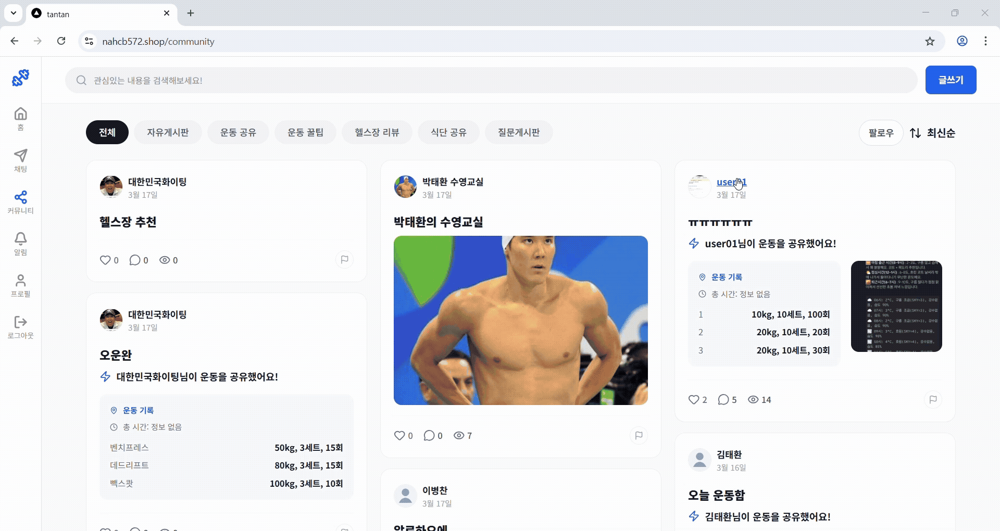
  

  
🏋️ 헬스장 탐색 / 예약

  
초기 조회화면(지역기준)

  

    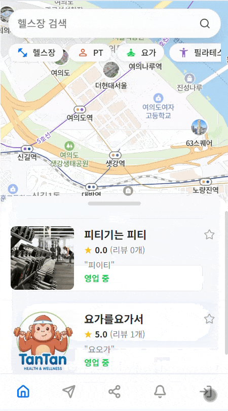
  

  
지도 기반 헬스장 조회

  

    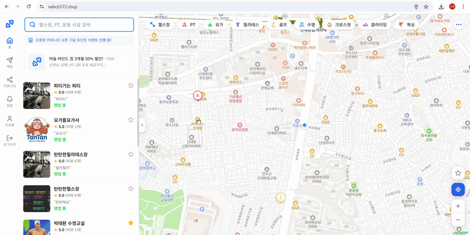
  

  
헬스장 상세 조회

  

    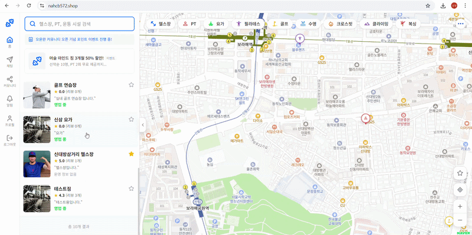
  

  
찜 등록 / 지도 찜 확인

  

    
  

  
헬스장 예약

  

    
  

  
💬 채팅

  
1:1 상담 채팅

  

    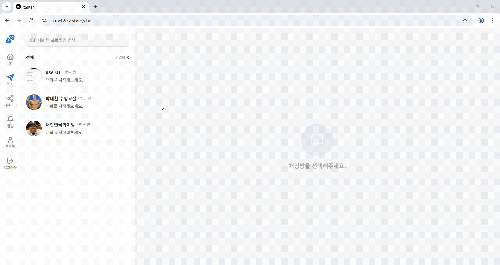
  

  
채팅방 검색

  

    
  

  
채팅방 내 검색 / 나가기

  

    
  

  
🏃 운동 기록

  
운동기록 등록

  

    
  

  
운동기록 일별 조회

  

    
  

  
운동기록 삭제

  

    
  

  
📝 리뷰 / 신고 / 알림

  
리뷰 등록

  

    
  

  
리뷰 수정

  

    
  

  
신고

  

    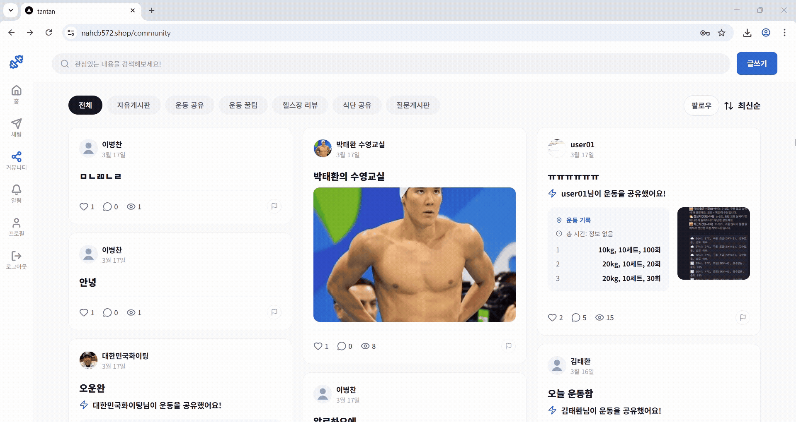
  

  
알림 읽음 / 삭제 처리

  

    
  

  
⚙️ 관리자 화면

  
헬스장 / 신고 처리

  

    
  

  
📝 커뮤니티

  
일반 게시글 작성

  

    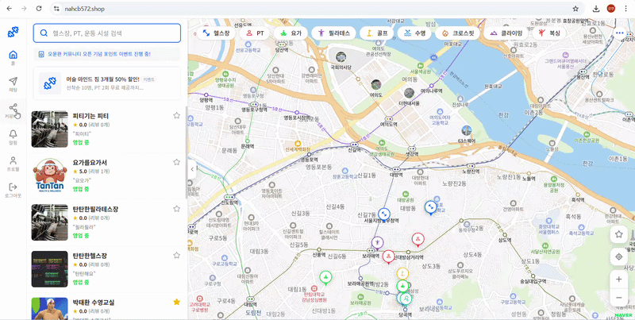
  

  
운동 기록 게시글 작성

  

    
  

  
게시글 상세 / 수정 / 삭제

  

    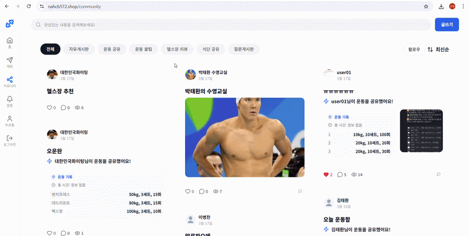
  

  
게시글 검색

  

    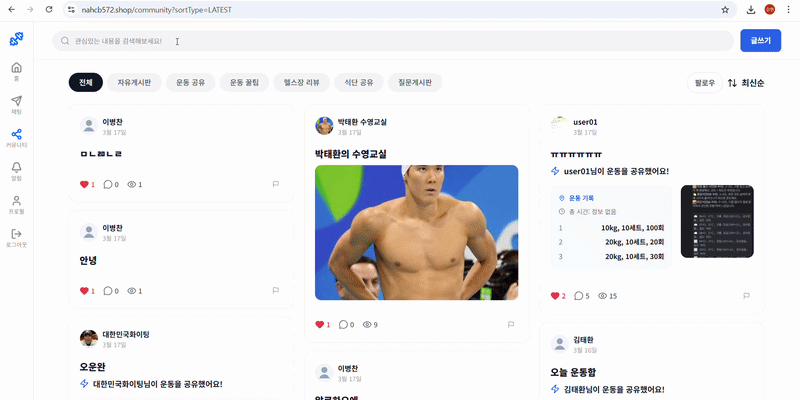
  

  
게시글 카테고리 검색

  

    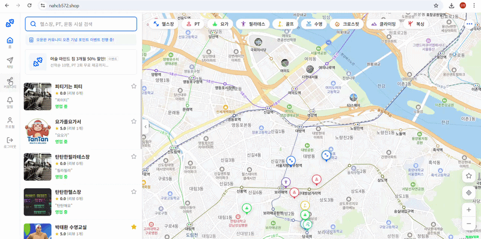
  

  
게시글 정렬

  

    
  

  
좋아요

  

    
  

  
댓글 / 답글

  

    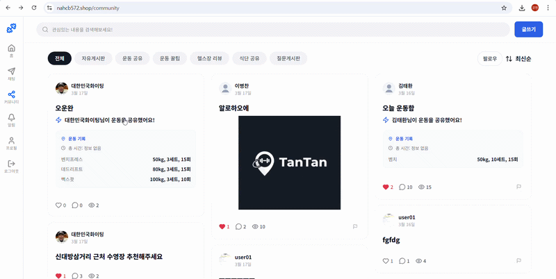
  

