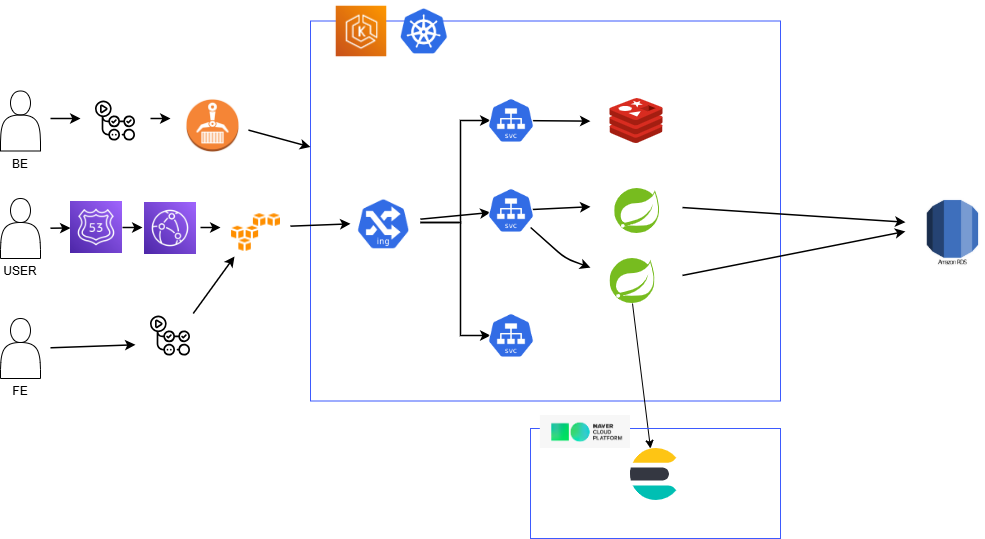

### **프로젝트 소개** 
TanTan은 지도를 중심으로 헬스장을 찾고, 비교하고, 문의까지 이어지게 만드는 웹앱입니다. 사용자는 네이버지도처럼 지도를 먼저 탐색하다가 핀을 클릭하면 왼쪽 슬라이드 패널로 해당 헬스장의 상세 정보가 자연스럽게 펼쳐지는 UI로, 원하는 헬스장을 빠르게 파악할 수 있습니다. 
헬스장 상세 페이지에서는 헬스장 이름/주소/사진/평균 별점/리뷰 목록을 확인할 수 있고, 마음에 들면 즐겨찾기로 저장하거나 **1:1 상담 채팅(비실시간, DB 기반)**으로 문의를 남길 수 있습니다. 채팅은 사용자와 헬스장 관리자가 여러 메시지를 주고받으며 기록이 남는 형태로, “문의 → 응답 → 기록 관리”가 간단하게 돌아가도록 구성합니다. 
TanTan은 사용자뿐 아니라 **헬스장 관리자(GYM_OWNER)**도 고려합니다. 헬스장 관리자는 본인 소속 헬스장만 등록/수정할 수 있고, 들어온 상담 채팅 목록을 확인해 응답할 수 있습니다. 또한 악성 리뷰 신고 등 운영에 필요한 최소 기능을 포함해, “헬스장 운영 관점”에서도 사용할 수 있게 설계했습니다. 
추가로 커뮤니티(게시글/댓글/대댓글)와 운동 기록(일일 기록, 월간 캘린더 표시) 기능을 통해, 단순한 지도 검색을 넘어 사용자 참여와 재방문을 만드는 서비스 구조를 갖추었습니다.
권한은 **일반 사용자(USER) / 헬스장 관리자(GYM_OWNER) / 관리자(ADMIN)**로 분리되고, 인증은 JWT Token 기반으로 구현하였습니다. 
## 🫂 팀원 소개
<table align="center">
  <tbody>
    <tr>
  <td align="center" width="150px">
    <a href="https://github.com/iamxoghks">
       
      <b> 김태환 </b>
    </a>
  </td>

  <td align="center" width="150px">
    <a href="https://github.com/2001056">
       
      <b> 이병찬 </b>
    </a>
  </td>

  <td align="center" width="150px">
    <a href="https://github.com/ybrocks">
       
      <b> 조강현 </b>
    </a>
  </td>

  <td align="center" width="150px">
    <a href="https://github.com/yune22">
       
      <b> 황정윤 </b>
    </a>
  </td>
</tr>
  </tbody>
</table>

## 🛠️ 기술스택
### 🧩 백엔드 기술

  
  
  
  
  
  

### 🎨 프론트엔드 기술

  
  
  
  
  
  
  
  
  
  

### 🗄️ 데이터 기술

  
  
  
  

### 🚀 인프라/배포

  
  
  
  
  
  

### 🧰 개발 도구

  
  
  
  
  
  

### 🤝 협업/기획 도구

  
  
  
  
  

### 🖥️ 주요 기능 소개(테스트케이스)

  
👤 회원 / 프로필

  
일반 회원가입 / 로그인

  

    
  

  
프로필 수정

  

    
  

  
팔로우

  

    
  

  
🏋️ 헬스장 탐색 / 예약

  
초기 조회화면(지역기준)

  

    
  

  
지도 기반 헬스장 조회

  

    
  

  
헬스장 상세 조회

  

    
  

  
찜 등록 / 지도 찜 확인

  

    
  

  
헬스장 예약

  

    
  

  
💬 채팅

  
1:1 상담 채팅

  

    
  

  
채팅방 검색

  

    
  

  
채팅방 내 검색 / 나가기

  

    
  

  
🏃 운동 기록

  
운동기록 등록

  

    
  

  
운동기록 일별 조회

  

    
  

  
운동기록 삭제

  

    
  

  
📝 리뷰 / 신고 / 알림

  
리뷰 등록

  

    
  

  
리뷰 수정

  

    
  

  
신고

  

    
  

  
알림 읽음 / 삭제 처리

  

    
  

  
⚙️ 관리자 화면

  
헬스장 / 신고 처리

  

    
  

  
📝 커뮤니티

  
일반 게시글 작성

  

    
  

  
운동 기록 게시글 작성

  

    
  

  
게시글 상세 / 수정 / 삭제

  

    
  

  
게시글 검색

  

    
  

  
게시글 카테고리 검색

  

    
  

  
게시글 정렬

  

    
  

  
좋아요

  

    
  

  
댓글 / 답글

  

    
  

### 🌐 외부 API 연동
| API | 사용 목적 | 적용 위치 |
| ---------- | ---------------------------------------------- | ---------------------------------------------- |
| **Naver Map API** | 주소를 좌표로 변환하는 **Geocoding API**와 차량 경로를 계산하는 **Driving Direction API**를 연동해 지도 탐색과 길찾기 경험을 제공합니다. | `MapController`, `GeocodingService`, `DrivingDirectionService`, `naver.map.*` 설정 |
| **사업자등록번호 조회 API** | 헬스장 관리자 권한 신청 시 사업자등록번호의 유효성과 정상 영업 여부를 검증해 허위 등록을 차단합니다. | `GymController`의 `/gym/apply`, `NtsBusinessApiClient`, `publicdata.nts.serviceKey` 설정 |

### 📦 사용 오픈소스
| 오픈소스 | 버전 | 사용 목적 | 라이선스 | 링크 |
| ---------- | ---------- | ---------- | ---------- | ---------- |
| Thumbnailator | 0.4.20 | 업로드 이미지의 비율을 유지한 썸네일 생성 및 원본/썸네일 분리 저장 | MIT | [coobird/thumbnailator](https://github.com/coobird/thumbnailator) |

### 🔍 사용한 핵심 기술
<table>
  <thead>
    <tr>
      <th>대분류</th>
      <th>소분류</th>
      <th>설명</th>
    </tr>
  </thead>
  <tbody>
    <tr>
      <td rowspan="2">UI 아키텍처</td>
      <td>Vue 3 Composition API</td>
      <td><code>useSession</code>, <code>useNotificationCenter</code> 같은 Composable 패턴으로 화면 로직을 기능 단위로 분리하고 재사용성을 높였습니다.</td>
    </tr>
    <tr>
      <td>Tailwind CSS + 커스텀 CSS</td>
      <td>빠른 화면 구축은 Tailwind로 처리하고, 지도 오버레이 같은 복잡한 레이아웃은 별도 CSS로 보완해 구현 유연성을 확보했습니다.</td>
    </tr>
    <tr>
      <td rowspan="2">라우팅/권한</td>
      <td>Vue Router 기반 SPA 라우팅</td>
      <td>단일 페이지 전환을 부드럽게 유지하면서 사용자, 헬스장 관리자, 관리자 권한에 따른 접근 제어를 구성했습니다.</td>
    </tr>
    <tr>
      <td>Navigation Guard</td>
      <td>라우터 가드와 세션 동기화를 결합해 인증이 필요한 화면 진입 시 역할과 로그인 상태를 검증합니다.</td>
    </tr>
    <tr>
      <td rowspan="2">인증/세션</td>
      <td>Axios Interceptor 기반 인증 제어</td>
      <td>Access Token 주입, Refresh Token 기반 재발급, 동시 요청 대기 큐를 interceptor 레벨에서 일관되게 관리합니다.</td>
    </tr>
    <tr>
      <td>경량 전역 상태 관리</td>
      <td>Vuex/Pinia 없이 Composition API의 <code>ref</code>, <code>reactive</code>를 활용해 세션, unread 상태, 모달 상태를 가볍게 유지합니다.</td>
    </tr>
    <tr>
      <td rowspan="2">실시간 처리</td>
      <td>STOMP &amp; WebSocket 채팅</td>
      <td><code>@stomp/stompjs</code>와 개인 채널 구독 구조를 이용해 1:1 상담 채팅과 채팅 unread 동기화를 처리합니다.</td>
    </tr>
    <tr>
      <td>SSE 알림 수신</td>
      <td>SSE 구독과 unread center를 조합해 알림 목록, 배지, 읽음 상태를 실시간에 가깝게 갱신합니다.</td>
    </tr>
    <tr>
      <td rowspan="2">지도/탐색 UX</td>
      <td>Naver Map API 연동</td>
      <td>위치 기반 검색과 지도 탐색 흐름을 FE에서 자연스럽게 연결해 지도 중심 UX를 구성했습니다.</td>
    </tr>
    <tr>
      <td>커스텀 슬라이드 패널 UI</td>
      <td>마커 클릭 시 좌측 패널이 이어지는 인터랙션을 통해 지도와 상세 정보 탐색을 한 흐름으로 묶었습니다.</td>
    </tr>
    <tr>
      <td>개발 생산성</td>
      <td>Vite</td>
      <td>빠른 HMR과 짧은 번들 시간을 바탕으로 화면 수정과 검증 사이클을 줄였습니다.</td>
    </tr>
  </tbody>
</table>

## 🛠️ 시스템 아키텍쳐

- 외부 트래픽은 **NGINX Ingress**를 통해 진입하며, TLS 종료와 CORS 정책 적용 후 Kubernetes 내부의 Spring Boot 서비스로 라우팅됩니다.

## 🚦 트러블 슈팅

  
🔍 1. 검색 (Elasticsearch 동기화 패턴)

1. **문제 상황**
   - 게시글 작성/수정 시 메인 DB(MariaDB)와 검색 엔진(Elasticsearch) 간의 데이터를 동기화해야 함.
   - 초기에는 게시글 저장 트랜잭션 내에서 동기적으로 ES에 인덱싱 API를 호출함.
   - **원인:** ES 서버에 일시적인 장애가 발생하거나 네트워크 지연이 생기면, 게시글 작성 자체(메인 트랜잭션)가 실패하거나 응답 속도가 심각하게 저하되는 강결합 문제 발생.

2. **시도**
   - 스프링의 `@Async`와 `ApplicationEventPublisher`를 활용해 비동기로 ES 인덱싱을 처리하도록 변경.
   - 하지만 메인 DB 트랜잭션이 롤백되어도 비동기 이벤트는 이미 발행되어 ES에 가짜 데이터가 남거나, 서버가 갑자기 다운되면 이벤트 큐 메모리가 날아가 데이터 유실(정합성 깨짐) 발생.

3. **해결 방안**
   - **트랜잭셔널 아웃박스(Transactional Outbox) 패턴** 도입.
   - 게시글 저장 시 동일한 트랜잭션 내에서 Outbox 테이블에 'ES 인덱싱 필요' 이벤트를 DB에 저장하여 원자성(Atomicity) 보장.
   - 별도의 스케줄러(배치 워커)가 주기적으로 Outbox 테이블을 폴링하여 비동기로 ES에 동기화한 뒤, 성공한 이벤트만 처리 완료(마킹 및 삭제) 처리.
   - 메인 로직의 응답 속도를 보장하면서도, ES 서버 장애 시에도 이벤트가 유실되지 않아 **최종적 일관성(Eventual Consistency)** 확보.

  
🖼️ 2. 이미지 시스템 (썸네일 도입을 통한 네트워크 부하 및 UX 개선)

1. **문제 상황**
   - 헬스장 피드 및 커뮤니티 게시글 목록 조회 시, 사용자가 업로드한 고해상도 원본 이미지(평균 3~5MB)를 그대로 클라이언트(브라우저/앱)로 전송함.
   - **원인:** 한 페이지에 10개의 게시글만 있어도 약 30~50MB의 데이터를 다운로드해야 했습니다. 이로 인해 초기 렌더링 속도가 현저히 느려져 화면 끊김(레이아웃 시프트)이 발생했고, 모바일 환경의 사용자에게 불필요한 데이터(요금) 부담을 주었으며, S3 아웃바운드 트래픽 비용도 크게 증가했습니다.

2. **시도**
   - 프론트엔드 측에서 CSS(`width`, `height`)를 조절하여 이미지를 작게 보여주도록 처리했습니다.
   - 하지만 브라우저가 화면에 작게 그릴 뿐, 결국 수 MB에 달하는 원본 파일을 백그라운드에서 모두 다운로드해야 했으므로 **초기 로딩 지연과 네트워크 대역폭 낭비 문제는 전혀 해결되지 않았습니다.**
   - 서버 측에서 Java의 기본 `ImageIO`를 사용해 리사이징을 시도했으나, 압축 품질이 떨어지고 스마트폰 사진의 EXIF 메타데이터(회전 정보)가 무시되어 이미지가 눕혀서 저장되는 이슈가 발생했습니다.

3. **해결 방안 및 결과**
   - 검증된 이미지 처리 오픈소스인 **`Thumbnailator` 라이브러리**를 도입하여 이미지 업로드 파이프라인을 전면 개편했습니다.
   - 사용자가 이미지를 업로드하는 시점에 원본을 저장함과 동시에, 가로 400px 크기의 **최적화된 썸네일을 서버 메모리에서 비동기적으로 생성**하여 S3의 별도 경로(`/thumbnail/...`)에 분리 저장했습니다.
   - 목록(List) API에서는 썸네일 URL을, 상세(Detail) API에서는 원본 URL을 반환하도록 응답 DTO를 분리했습니다.
   - **📊 성능 및 UX 개선 지표:**
     - **데이터 절감:** 1장당 평균 3MB에 달하던 이미지 용량이 **약 80~100KB 수준으로 감소**하여, **네트워크 페이로드(부하)를 약 96% 이상 획기적으로 절감**했습니다.
     - **속도 향상:** 수십 MB를 다운로드하느라 수 초가 걸리던 목록 페이지 로딩 속도가 **0.5초 이내로 단축**되었습니다.
     - **UX 및 리소스:** 사용자는 모바일 데이터를 절약하면서도 지연 없이 매끄러운 스크롤(Feed) 경험을 할 수 있게 되었고, 서버 측면에서는 S3 데이터 전송 비용을 극적으로 낮추는 일석이조의 효과를 달성했습니다.

  
🚀 3. 대규모 데이터 조회 (Redis 랭킹/정렬)

1. **문제 상황**
   - 특정 헬스장의 '찜(즐겨찾기)' 숫자를 표시하거나, 유저들의 '팔로워/팔로잉' 목록을 최신순으로 조회할 때 RDBMS에 잦은 COUNT 및 ORDER BY 쿼리가 발생.
   - 특히 인기 있는 헬스장이나 유저의 경우 병목 지점이 되어 DB 부하가 심해짐.

2. **시도**
   - DB 쿼리 결과를 어플리케이션 레벨의 로컬 캐시(Ehcache 등)에 저장하려 했으나, 다중 서버(Scale-out) 환경에서 캐시 정합성이 맞지 않는 문제 발생.

3. **해결 방안**
   - 실시간 카운팅과 정렬이 필요한 데이터를 **Redis의 ZSet(Sorted Set)** 자료구조로 이관하여 관리.
   - 팔로우나 찜 이벤트 발생 시 ZSet에 데이터(Value: User ID, Score: Timestamp)를 `O(log N)` 시간 복잡도로 빠르게 추가/삭제.
   - 페이징 조회 시 ZSet의 `ZREVRANGE` 명령어를 사용하여 RDBMS의 디스크 I/O 없이 메모리 레벨에서 정렬된 목록을 초고속으로 추출.
   - DB 부하를 대폭 낮추고 대용량 트래픽에서도 안정적인 조회 성능 보장.

  
🔔 4. 실시간 알림 (SSE 스레드 병목)

1. **문제 상황**
   - 헬스장 관리자가 공지를 올리거나 특정 이벤트가 발생했을 때, 해당 헬스장을 찜한 수많은 사용자에게 실시간 알림(SSE)을 발송해야 함.
   - 팔로워 목록을 순회하며 SSE Emitter로 메시지를 전송하는 과정이 메인 스레드에서 동기적으로 처리됨.
   - 팔로워가 많은 경우, 공지 작성 API의 응답 지연(Timeout)이 발생하고 서버의 톰캣 스레드 풀이 고갈될 위험이 있음.

2. **시도**
   - Java의 `parallelStream()`을 사용하여 병렬 처리를 시도했으나, 공용 ForkJoinPool을 사용하여 다른 일반 비즈니스 요청 처리에도 영향을 미쳐 전체 서버 성능이 불안정해짐.

3. **해결 방안**
   - 알림 전송 로직을 `@Async` 어노테이션을 활용해 별도의 커스텀 스레드 풀(TaskExecutor)로 분리하여 비동기 처리. 메인 API는 알림 발송과 무관하게 즉시 200 OK 응답.
   - 다중 서버(인스턴스) 환경에서 사용자가 어느 서버에 연결되어 있는지 알 수 없는 문제를 해결하기 위해, 비동기 스레드에서 **Redis Pub/Sub**으로 알림 메시지를 브로드캐스팅.
   - 각 서버 인스턴스가 메시지를 구독(Subscribe)하여, 자신이 관리하고 있는(로컬 메모리에 있는) Emitter에만 알림을 발송하도록 구조를 개선하여 지연 없는 대규모 실시간 알림 구현.

  
💬 5. 채팅 시스템 (WebSocket 다중 구독 부하 최적화)

1. **문제 상황**
   - 사용자가 로그인하여 채팅 기능을 사용할 때, 채팅 목록의 최신 메시지와 안 읽은 개수를 실시간으로 갱신하려면 자신이 속한 모든 채팅방을 각각 구독하는 구조로 가기 쉬웠음. 초기 관점도 각 방 단위 구독(`/user/queue/chat/rooms/{roomKey}`)을 여러 개 유지해서 목록과 본문을 모두 처리하는 방향과 유사했음.
   - **원인:** 일반 사용자에게는 채팅방 수가 적어 큰 문제가 없지만, 다수의 회원과 1:1 문의 채널을 유지하는 헬스장 관리자(GYM_OWNER)의 경우 로그인 직후 매우 많은 방에 대한 STOMP 구독이 필요해짐. 
   - 이 경우 클라이언트는 방 수만큼 구독 상태를 직접 관리해야 하고, 서버 역시 사용자별 세션과 구독 정보를 대량으로 유지해야 함. 또한 현재 프로젝트에서는 특정 방 구독이 단순 수신 의미만이 아니라 “지금 이 방을 보고 있음”이라는 presence/read 의미까지 가지므로, 전 방 구독 방식은 읽음 처리와 타이핑 상태까지 왜곡할 위험이 있었음.
   - 이로 인해 서버의 WebSocket 세션 및 메시지 브로커 관리 비용이 커지고, 동시 접속자가 늘어날 경우 불필요한 메모리 사용과 트래픽 브로드캐스팅이 누적되어 전체 채팅 성능 저하로 이어질 가능성이 컸음.

2. **시도**
   - 웹소켓 구독 수를 줄이기 위해 채팅 목록 화면에서 REST API를 짧은 주기로 폴링하여 최신 메시지와 안 읽은 개수를 갱신하는 방안도 검토함.
   - 하지만 이 방식은 실시간성이 떨어져 UX가 나빠졌고, 목록 갱신을 위해 다수의 사용자가 주기적으로 DB 조회를 발생시키면서 애플리케이션 서버와 데이터베이스에 새로운 부하를 유발하는 문제가 있었음. (WebSocket 구독 부하를 줄이는 대신 Polling 기반의 I/O 부하로 병목이 이동하는 Trade-off 발생)

3. **해결 방안 및 결과**
   - 채팅 목록 갱신과 현재 방 본문 수신의 목적을 분리하여, **`목록용 inbox 채널`과 `활성 방 room 채널`을 함께 사용하는 Two-Track Subscription 구조**로 개선함.
   - **채팅 목록 최적화:** 사용자는 로그인 시 전체 채팅 목록용 개인 채널인 `/user/queue/chat/inbox` 하나만 구독함. 서버는 어떤 채팅방에서 메시지가 생성되든, 해당 수신자에게 `roomKey`, 최신 메시지 정보, unread 갱신 트리거가 포함된 요약 이벤트를 inbox로 발행함. 이를 통해 채팅 목록의 최신 메시지, 정렬 순서, NavRail 배지를 실시간으로 갱신할 수 있도록 구성함.
   - **채팅방 진입 시 개별 구독:** 사용자가 특정 채팅방에 실제로 입장했을 때만 해당 방의 `/user/queue/chat/rooms/{roomKey}`를 구독하도록 구성함. 이 채널은 현재 활성 방의 본문 메시지, 타이핑 상태(`TYPING_START`, `TYPING_STOP`), 읽음 처리와 같은 상세 스트림만 담당하며, 방을 벗어나면 즉시 구독을 해제함.
   - **추가 최적화:**
     - inbox 채널은 목록 갱신에 필요한 `MESSAGE` 이벤트만 수신하도록 제한하고, typing 이벤트는 제외함.
     - typing 이벤트는 현재 활성 방 채널에서만 수신하도록 분리함.
     - 발신자 본인에게 불필요하게 되돌아오던 typing echo를 제거하여 트래픽을 추가로 절감함.
   - **📊 성능 및 아키텍처 개선 결과:**
     - 1인당 발생하는 WebSocket 구독 수를 채팅방 개수에 비례하는 구조에서, **`inbox 1개 + 활성 room 1개` 수준의 상수 시간 구조로 축소함.** (구독 수를 사실상 `O(N)`에서 `O(1)` 수준으로 줄여 클라이언트와 서버 양쪽의 구독 관리 비용을 크게 낮춤)
     - 목록 갱신과 본문 수신의 책임을 분리함으로써 채팅 목록 갱신은 가볍게 유지하고, 현재 방의 읽음 처리, presence, typing 의미는 정확하게 보존하며 대규모 1:1 채널 환경에서도 안정적으로 실시간 채팅 기능을 제공할 수 있게 됨.

## 📄 기획
### 🧩 ERD 모델링
[ERD설계](https://www.erdcloud.com/d/ntgkZ9ocSqbtQKYMS)

### 🗂️ WBS(Work Breakdown Structure)
[WBS](https://docs.google.com/spreadsheets/d/1UjxzOpptgDh60qLhGtd6FsADTPM40OOCVrUY1_OP__w/edit?usp=sharing)

### 📬 Postman API
[Postman Workspace](https://www.postman.com/bold-rocket-952382/workspace/be23-2nd-team1-tantan)

### 🎨 디자인
[Figma](https://www.figma.com/make/Zu6ksFFLS1pRErocl6wR63/TanTan-%EC%A7%80%EB%8F%84-%EA%B8%B0%EB%B0%98-%EC%9B%B9%EC%95%B1-UI?t=t98E30dOLmbsPKSH-1),
[Google Stitch](https://stitch.withgoogle.com/projects/12574759648480207988),
[실 디자인 v0.2](https://tantan-proejct-front-temp.vercel.app)

### 📄 주요기능, 요구사항명세서, 팀 전략
[요구사항 명세서](https://docs.google.com/spreadsheets/d/1UjxzOpptgDh60qLhGtd6FsADTPM40OOCVrUY1_OP__w/edit?gid=2109308759#gid=2109308759)
